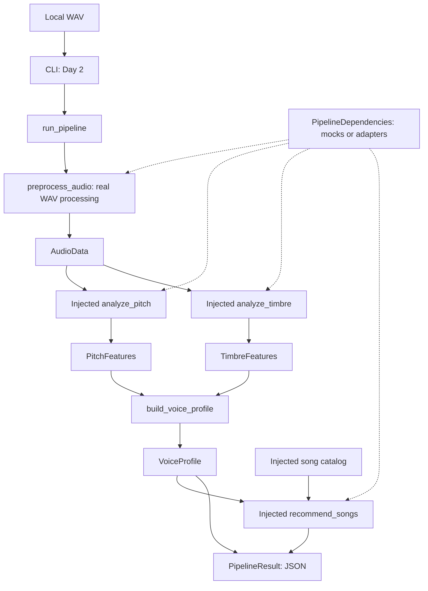

# Main pipeline architecture

The local application owns orchestration. Independent adapters own analysis and
ranking. Existing experiments remain research workspaces and are not moved,
rewritten, or imported on the default application path.



All runtime nodes above are planned for Day 2. Day 1 implements only their data
boundaries and callable signatures. There is no command that runs analysis yet.

## Package placement

```text
docs/                              # shared design and handoff documents (Day 1)
main_pipeline/
  README.md                        # scope and development entry point
  src/suara/
    __init__.py                    # no runtime imports or model loading
    contracts.py                   # Day 1 schemas, errors, protocols
    pipeline.py                    # Day 2: orchestration and profile assembly
    cli.py                         # Day 2: arguments, JSON, exit codes
    audio/preprocessing.py         # Day 2: real WAV preprocessing
    modules/                       # future real adapter modules
    mocks/                         # Day 2: deterministic fixtures and catalog
  pyproject.toml                   # Day 2: isolated installable package
  tests/                           # Day 3: synthetic audio and integration tests
experiments/                       # existing work preserved
```

Only the files marked Day 1 and the README exist in this change. Do not create
empty runtime placeholders that imply functionality. Day 2 package installation
will target `main_pipeline/`, not the repository root or an experiment package.

## Execution and dependency direction

`contracts` uses only Python's standard library. Adapters depend on contracts;
contracts never depend on adapters. Importing `suara` must not import librosa,
Torch, TensorFlow, experiment scripts, or download checkpoints. NumPy and an
audio/resampling library may be justified in Day 2; none is needed for Day 1.

The orchestrator validates options and a unique-ID catalog, loads the recording
once, validates each analyzer result, builds the profile, calls the recommender,
checks that outputs refer to catalog entries, checks order/count/provenance, and
returns the result. Analyze sequentially initially; do not add workers or an API.

Use the `PipelineDependencies` bundle for the preprocessor, pitch analyzer, timbre
analyzer and recommender. Functions or callable objects satisfy the protocols.
Profile assembly remains a small deterministic pipeline responsibility; its
protocol documents the transformation without requiring injection.

`dependencies=None` in mock mode will select the default real preprocessor plus
mock analyzers/recommender. `song_catalog=None` selects the mock catalog only in
mock mode; an explicit empty catalog stays empty. Real mode requires explicit
dependencies and a catalog. Missing or mock components cause a configuration
error, not fallback. Mixed adapters can be tested in mock mode; their feature
modes remain visible and the aggregate analysis mode is mock if any analysis
component is mock. A mock catalog also forces mock recommendation provenance.
`real` means derived by a real algorithm, not validated accurate or suitable.

## Failure and privacy boundaries

No partial success result is returned when a stage fails. Modules raise
`PipelineError(ErrorInfo(...))` for expected failures. The orchestrator wraps
schema violations and unexpected adapter exceptions with the appropriate public
code/stage, retaining the original cause locally. Public JSON must omit tracebacks,
absolute paths, participant identities, and recording contents. The future CLI
writes success JSON to stdout (exit 0); failure JSON to stderr (exit 2).

Waveforms are transient in-memory values. Do not include them in `PipelineResult`,
persist them automatically, or add E6 material to tests. AudioData JSON examples
are for developer interoperability; routine logs should use metadata only.

## Versioning and limitations

Schema `1.0.0` describes field meanings, nullability, and validation. Model,
processing, song-feature, scoring and pipeline versions describe independently
changing implementations. Changes to units, MFCC dimension or meaning require a
schema migration, not a quiet adapter change. Parameter changes require a new
processing version; comparisons require the same processing version.

The initial list waveform is a dependency-free boundary representation, not a
large-file transport format. The 60 s limit caps its memory cost. A future NumPy
boundary needs a coordinated contract change. Runtime validation cannot prove
that a module truthfully labels measured versus synthetic data; adapter review
and provenance checks remain necessary. E3's Python 3.11 environment cannot be
loaded wholesale into this Python 3.12 application; use a teammate-exported
catalog or a separately designed adapter rather than adding its full stack.
